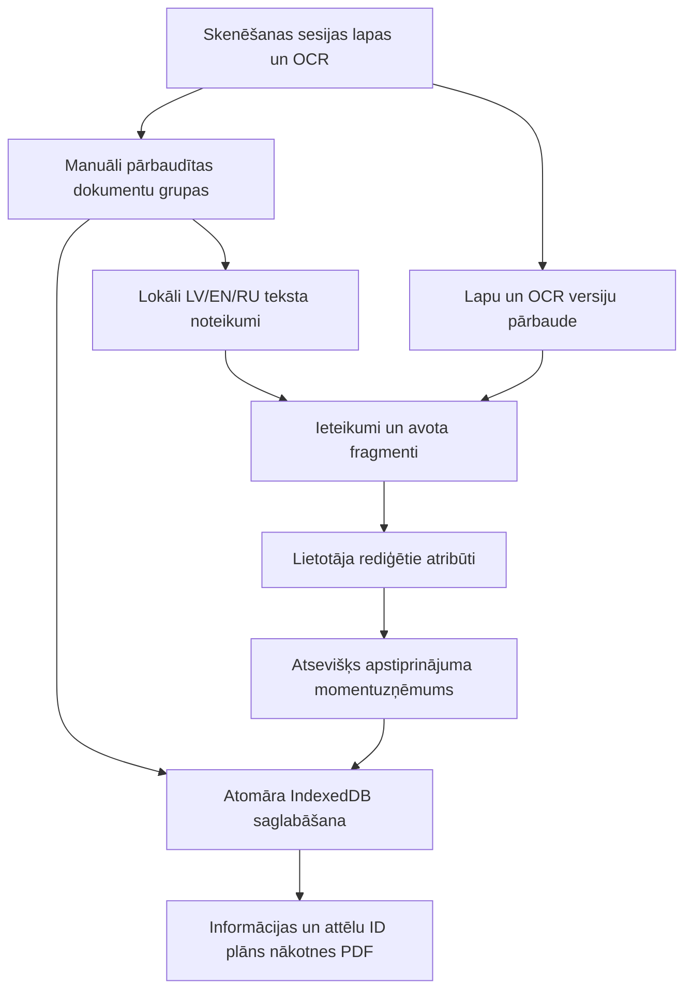
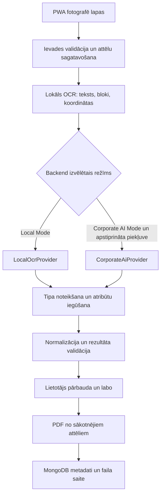

# Dokumentu apstrādes arhitektūra

## Pārlūka 5. posmā realizētā plūsma

`features/documents/analysis.js` analizē tikai dokumentam piesaistītās lapas; `model.js` pārvalda piederību, secību, kartītes un aktualitāti. Ieteikumi, manuālie dati un apstiprinājums ir atsevišķi. Saglabāšana izmanto esošo melnraksta transakciju bez attēlu dublēšanas. Pilna automātiska grupēšana, PDF un backend nav ieviesti. [5. posma pārskats](../testing/document-grouping.md).

Turpmākās sadaļas apraksta sākotnējo CLI prototipu un nākotnes servera arhitektūru, nevis pašreizējās pārlūka lietotnes darbības prasības.

## Plānotā plūsma

PWA, automātiska lapu grupēšana, PDF izveide un MongoDB reģistrācija šajā posmā ir tikai plānotas. Pašreizējais CLI izpilda attēla/PDF ievades validāciju, PDF rastrēšanu, EXIF orientāciju, izvēles Tesseract OSD, OCR un nelielu lokālu semantikas eksperimentu. PDF rastrēšana ir ievade OCR pārbaudei; jauni arhīva PDF netiek ģenerēti.

## Komponenšu robežas

| Komponente         | Atbildība                                           | Šī posma realizācija                                        |
| ------------------ | --------------------------------------------------- | ----------------------------------------------------------- |
| Ievade un attēli   | Saturs, baitu/pikseļu/lapu limiti, orientācija      | `ocr_demo.input_pages`; 25 MiB, 40 MP/lapā, 20 lapas        |
| OCR                | Teksts, vārdi, rindas, robežas, dzinēja novērtējumi | `engines.TesseractEngine`; Paddle adapteris nav validēts    |
| Klasifikācija      | Dokumenta nozīme, `unknown` nenoteiktībā            | Daži virsraksti `analysis.py`                               |
| Atribūti           | Lauku nozīme un avoti                               | Ierobežots LV/EN/RU apzīmējumu eksperiments                 |
| Normalizācija      | Datumi, decimālvirknes, vienādas nozīmes atslēgas   | Neatkarīgas funkcijas, `null` divdomīgos gadījumos          |
| Validācija         | Vienots atbildes līgums                             | JSON shēma; faktiskie 14 rezultāti pārbaudīti pret to       |
| Lietotāja pārbaude | Labojumi un apstiprinājuma notikums                 | Prasība `requires_review: true`; saskarne vēl nav izveidota |
| PDF un krātuve     | Oriģinālā vizuālā satura saglabāšana un MongoDB     | Vēlākas kartītes                                            |

`DocumentAnalysisProvider` ir aizvietojamības robeža. Python prototips palīdz pārbaudīt līgumu; Laravel pusē nākamajā posmā jāizveido ekvivalents PHP interfeiss un konfigurācijas reģistrs. Nav uzstādīts Laravel, veidots HTTP serveris vai mikroserviss.

Sākotnēji Laravel rindas uzdevums var palaist CLI kā izolētu procesu, argumentus padodot masīvā bez čaulas interpolācijas. JSON lasa no privāta rezultāta faila, pārbauda shēmu, kļūdas kodu un procesa statusu. Web procesa tiesības, darba direktoriju izolācija, paralēlisms, kopējais uzdevuma laika/atmiņas limits un privāto rezultātu glabāšanas termiņš jāievieš pirms produkcijas. Pašreizējais `--timeout` ierobežo katru Tesseract procesu; tas nav visa PDF uzdevuma limits un neattiecas uz Paddle inferenci.

Local Mode neizsauc ārēju API. Corporate AI Mode nav pieejams līdz saskaņošanai; neatbildēšana nerada automātisku ārēju fallback. Vēlāk vietēja dokumentu izpratnes modeļa adapteri var pievienot aiz tā paša interfeisa, atsevišķi pārbaudot modeļa licenci, resursus un kvalitāti.

## Vispārināmības pārbaude

Teksta koordinātas un lasīšanas secība sniedz kontekstu; tās nedrīkst kļūt par fiksētām uzņēmumu zonām. Ražošanas semantikai jādarbojas ar jaunām valodām, virsrakstiem un izkārtojumiem. Tās novērtēšanai nepieciešama no izstrādes nodalīta pārbaudes kopa ar iepriekš neredzētiem izdevējiem. Pašreizējie piemēri un sintētiskie testi šādu rezultātu vēl nepierāda.

Dokumentā rakstītas komandas ir neuzticams saturs arī nākotnes MI adapterim. Rīku izsaukumus, tīkla adreses un atļaujas nosaka backend konfigurācija. Pilnu tekstu un bankas/personas datus nedrīkst iekļaut parastos diagnostikas žurnālos.
